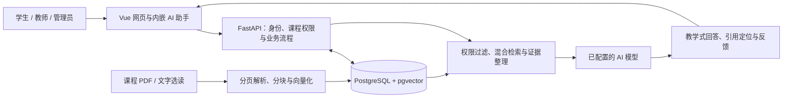

# 智学助手

面向计算机课程的 AI 辅助教学与学习平台。系统以**课程**组织教学内容，将课程资料、知识问答、练习、作业、教学分析和课表管理串联起来。学生、教师和管理员使用同一个网页入口，登录后进入各自的工作区；内嵌 AI 助手根据角色与当前页面提供帮助。

本仓库包含前后端源码、数据库迁移、课程资料来源登记、部署与迁移工具。本公开版包含完整功能代码、原创演示资料和示例配置；使用者自行配置模型与课程数据。代码采用 AGPL-3.0-only，详见 [LICENSE](LICENSE) 和 [第三方声明](THIRD_PARTY_NOTICES.md)。

[项目设计与架构](docs/architecture.md) · [部署手册](docs/deployment-guide.md) · [完整换机迁移](docs/simple-migration.md) · [开发路线](docs/roadmap.md) · [GitHub Actions](https://github.com/zheliang717/computer-course-rag/actions)

## 1. 项目功能与角色

### 三个角色的工作区

| 角色 | 主要功能 | AI 助手侧重 |
| --- | --- | --- |
| 学生 | 首页查看各课程进度、作业与课表；浏览课程概览、大纲、知识点和对应资料；完成练习与作业、错题再练；查看成绩反馈；管理笔记、学习计划和个人资料。 | 结合课程资料讲解知识，展示可定位的引用；针对当前题目提供辅导，推荐复习与练习，辅助制定学习计划。正式作业遵循教师设置的 AI 辅助范围。 |
| 教师 | 维护所授课程内容、章节与资料；管理课程成员和公告；手动出题、从私有 PDF 选编原题或生成待审核题目；组卷、发布作业、批改和查看学情；提交调课申请。 | 备课、完善大纲、辅助出题与审题、生成讲评和评语建议、分析个人作答及课程学生的整体成绩与薄弱点。教师确认后才入库、发布或形成最终成绩。 |
| 管理员 | 管理用户、注册规则、邀请与账号协助；维护课程、资料库、学期、教室和课表；审批调课；配置模型、额度与检索参数；查看评测、日志和数据导出。 | 解释管理数据、排查资料处理问题、辅助排课和准备管理操作；涉及实际更改的流程先预览，再由管理员确认。 |

权限在服务端按角色和课程关系核对。新业务按课程分配；旧班级 API 保留兼容，不作为当前页面的主要组织方式。

### 主要业务闭环

- **课程建设**：编辑概览、学习目标与考核方式 → 维护章节、知识点及资料阅读范围 → 保存草稿 → 预览并确认发布。AI 建议可逐项采纳，不会自行覆盖课程内容。
- **资料与 RAG**：上传文字型 PDF 或导入文字选读 → 解析分页、分块、建立索引 → 绑定课程 → 检索证据并辅助讲解。资料支持处理进度、失败重试、取消、历史版本和恢复。
- **题目与作业**：手动录题 / 资料原题选编 / AI 生成草稿 → 教师审核入库 → 组卷、调整顺序与分值 → 发布 → 学生提交 → 教师批改、反馈与学情回看。原题选编保留来源页与原文，教师私有出题 PDF 与学生检索资料分开。
- **练习与复习**：题库练习 → 作答反馈 → 错题待巩固 / 已巩固记录 → 到期复习与薄弱点推荐。推荐结合复习时间、薄弱知识点、新题和已授课内容；教师设计难度与作答样本统计难度分开显示。
- **课表管理**：维护学期、课次、教室和可用时段 → 检查冲突 / 计算候选 → 预览影响 → 管理员确认。教师只能申请调课；教师、学生或教室时间冲突会阻止保存。
- **账号与体验**：注册、邀请、审批与账号协助；个人中心、头像、修改密码、设备会话及可选七天免登录；列表查询与分页、响应式布局、固定弹窗操作和可手动收起的导航。

课程授课进度来自已确认的课次；章节作业进度来自学生实际提交。点击查看详情不会直接把进度变为完成。

## 2. 内嵌 AI 与 RAG 设计

AI 助手既有完整工作区，也有页面内的悬浮入口，共享当前会话与上下文。回答支持流式显示、等待阶段提示、停止与重试、历史回看、Markdown、公式、代码及资料定位。

| 回答模式 | 行为 |
| --- | --- |
| 课程优先（学生、教师默认） | 先检索有权访问的课程资料，由已配置的 AI 模型结合证据组织讲解；资料不足时允许补充通用知识，并区分来源。 |
| 严格课程 RAG | 以课程证据为约束；证据不足时说明无法据此回答。 |
| 通用助手 | 使用在线模型回答一般问题，不要求课程资料命中。 |

模型服务、模型名、凭据及检索设置由管理员维护；学生和教师页面使用统一的 AI 表达。系统支持兼容 OpenAI Chat Completions 的服务，不绑定某一家模型供应商。



向量检索结合关键词匹配，并保留资料标题、页码和片段关联。只有获准外发的资料片段才进入在线模型上下文；离线回退明确展示为证据摘录，不能等同于模型生成的讲解。

AI 辅助排课采用“模型整理需求 + 程序生成候选与检查约束 + 人工确认”，不是模型直接修改课表，也不保证全校最优安排。

## 3. 技术与运行结构

| 部分 | 实现 |
| --- | --- |
| 前端 | Vue 3、TypeScript、Vite；Markdown 与 KaTeX 公式渲染 |
| 后端 | Python 3.12、FastAPI、SQLAlchemy、Alembic |
| 持久化与检索 | PostgreSQL 16、pgvector；语义向量与关键词混合检索 |
| 资料处理 | PyMuPDF；数据库持久任务、处理状态与资料版本 |
| 模型接入 | 本地 Sentence Transformers 向量模型；兼容接口的在线生成模型；离线回退 |
| 部署与核对 | Docker Compose、pytest、Playwright、GitHub Actions |

标准部署有三个服务：`web` 提供页面及同站点 API 代理，`api` 执行业务，`postgres` 保存业务与检索数据。模型配置凭据经过加密，解密密钥保存在独立持久卷中；数据库备份不能代替该密钥。

## 4. 选择部署方式

| 需求 | 使用方式 | 是否带现有数据 |
| --- | --- | --- |
| 在新电脑开发代码，或安装一套新系统 | 从 GitHub 克隆，按下节构建并启动 | 不带现用数据库和私有配置 |
| 把当前完整系统搬到另一台 Windows x64 电脑 | `Export.cmd` 导出 → 复制整个迁移包 → 包内 `Import.cmd` 导入 | 包含账号、课程、资料索引、作业、成绩、配置、密钥、模型缓存和运行镜像 |
| 手机或另一台电脑访问同一套系统 | 给运行主机配置 HTTPS 访问入口 | 共用主机数据库，无需在访问设备安装项目 |

**GitHub 下载的源码不等于当前系统的完整备份。** 数据库、`.env`、模型凭据、模型缓存和迁移包均不提交到仓库。

## 5. 从源码部署一套新系统

以下为 Windows PowerShell 操作；在 Linux 上从源码部署可使用相同的 Node / Docker 构建流程，环境文件复制等命令需按系统调整。双击迁移工具仅支持 Windows x64。

### 5.1 准备环境

- Git，以及有权访问本仓库的 GitHub 账号（仓库为私有时需要登录）。
- Docker Desktop，已启动并使用 Linux 容器、Compose V2；Linux 主机可使用 Docker Engine 与 Compose V2。
- Node.js 22，用于首次构建前端。只运行 Docker 版时，宿主机不必另外安装 Python。
- 建议 16 GB 内存；为 Docker 镜像、模型缓存、数据库及备份预留磁盘空间。默认 CPU 路径无需独立显卡。

### 5.2 获取代码并创建配置

```powershell
git clone https://github.com/zheliang717/computer-course-rag.git
cd computer-course-rag
Copy-Item .env.example .env

# 为这套新系统生成独立的登录签名密钥。
$authSecret = [guid]::NewGuid().ToString('N') + [guid]::NewGuid().ToString('N')
(Get-Content .env) -replace '^AUTH_SECRET=.*$', "AUTH_SECRET=$authSecret" | Set-Content .env -Encoding utf8
```

这里只在**新安装**时复制 `.env.example`。升级或恢复现有系统时保留原 `.env` 和密钥。

### 5.3 构建前端并启动容器

```powershell
cd frontend
npm.cmd ci
npm.cmd run build
cd ..

docker compose -p computer-course-rag up --build -d
docker compose -p computer-course-rag ps
```

首次需要联网下载依赖和基础镜像。前端产物不在 Git 中，必须先执行前端构建；Web 镜像不会替你运行 `npm run build`。API 启动时自动升级数据库结构。

| 入口 | 地址 |
| --- | --- |
| 平台页面 | [http://127.0.0.1:5173/](http://127.0.0.1:5173/) |
| 健康检查 | [http://127.0.0.1:5173/health](http://127.0.0.1:5173/health) |
| API 调试文档 | [http://127.0.0.1:8000/docs](http://127.0.0.1:8000/docs) |

空库首次初始化的本地演示账号为：

| 角色 | 账号 | 初始密码 |
| --- | --- | --- |
| 管理员 | `admin` | `admin123` |
| 教师 | `teacher` | `teacher123` |
| 学生 | `student` | `student123` |

这些凭据只用于新建本地系统的演示，迁移后的系统沿用原账号密码。向其他人开放入口前，应更改演示密码和部署凭据。

### 5.4 配置 AI 与课程知识库

默认 `.env.example` 使用 `LLM_PROVIDER=offline` 和 `EMBEDDING_PROVIDER=hashing`，便于先验证登录与业务流程；**默认配置并未启用在线模型讲解或语义向量模型**。

1. 按[部署手册的模型配置步骤](docs/deployment-guide.md#3-启用语义检索与在线-ai)下载本地向量模型，设置模型名称并重启 API。首次建设资料库前完成；已有向量不能只换模型而不重建索引。
2. 管理员在模型与检索配置中填写兼容服务地址、模型名和自己的 API Key，检查连接后保存。已经保存的在线模型配置优先于 `.env` 默认值。
3. 创建课程和资料库，将资料库关联课程，上传文字型 PDF 或导入已登记的选读；等待处理成功，发布资料并设置在线模型使用范围。
4. 维护课程大纲、知识点与阅读范围，为教师和学生分配课程后，用相关问题核对回答及引用定位。

仓库中的 `materials/` 提供原创演示 PDF、来源登记和固定样题，不捆绑第三方教材原文，也不会因克隆代码就自动成为数据库里的知识库。需要恢复当前完整知识库时，使用下一节的整包迁移。

## 6. 将当前完整系统迁到其他电脑

适用于 **Windows x64 → Windows x64、Docker Linux / amd64 容器**。新电脑只为运行迁移后的系统时，需要 Docker Desktop，不需要安装 Git、Node.js 或 Python。

### 旧电脑：导出

1. 保持 Docker Desktop 与现有系统运行，在项目根目录双击 [`Export.cmd`](Export.cmd)。
2. 等待导出结束，打开项目目录旁的 `zhixue-migration-packages/zhixue-日期时间-编号/`。
3. 将这个**完整文件夹**复制到新电脑或移动硬盘；不要只复制源码或 `Import.cmd`。

导出会打包当前运行镜像、数据库一致性快照、模型配置密钥、源码与部署配置、资料文件和当前使用的模型缓存。如果检测到已部署的独立 Funnel 副本，也会分别导出其数据库与配置。镜像采用 gzip 压缩并校验解压后的完整性；开发依赖、历史修改副本、历史报告、旧备份及未使用的模型不重复打包。新导入器仍兼容旧的未压缩镜像包。

### 新电脑：导入

1. 安装并启动 Docker Desktop，确认使用 Linux 容器，且有足够空间存放迁移包和导入的镜像、数据。
2. 把迁移包放到准备长期保留的位置，双击**迁移包根目录**的 `Import.cmd`。
3. 等待校验、镜像导入、数据库与配置恢复；成功后打开 `http://127.0.0.1:5173/`。
4. 使用原账号登录，核对课程、资料、作业、成绩、课表及 AI 功能。已包含 Funnel 副本时，其本机入口是 `http://127.0.0.1:18080/`。

导入工具会在恢复前检查文件校验值、已有容器、数据卷和端口；发现已有安装时停止，不覆盖目标电脑的数据。报错后保留窗口和迁移包排查，不要通过删除数据卷强行重试。

迁移包包含实际业务数据及密钥，**不要上传 GitHub**。它是导出时的快照，两台电脑后续不会自动同步。正式切换前停止旧入口的新写入，再做最终导出；新电脑核对完成后再停用旧入口。浏览器中尚未提交的内容不在数据库快照内。

双击工具的校验及防覆盖检查已有验证；**尚未在另一台物理电脑完成整包恢复验收**。跨 Linux / ARM 平台需重新构建并单独迁移数据库与模型配置，不能直接套用这个 Windows 包。

更多说明见[简便迁移手册](docs/simple-migration.md)。

## 7. 让手机和其他设备访问

`127.0.0.1` 只代表当前访问设备自身。手机不能使用这个地址连接电脑；标准 Compose 也只监听主机回环地址。

可以把项目留在一台持续运行的主机上，通过 HTTPS 反向代理或 Tailscale Funnel 提供网址，其他设备只需浏览器。现有 Funnel 副本迁到新电脑后，需要重新安装、登录 Tailscale 并启用 Funnel；原网址不能假定会自动沿用，也不要重新初始化已恢复的副本。

具体步骤见[部署手册：跨设备访问](docs/deployment-guide.md#7-让其他设备访问)。需要长期运行时，保持主机与 Docker 在线；如改为服务器部署，仍需同时保管业务数据库、模型配置密钥和模型缓存。

## 8. 日常维护

在项目根目录执行：

```powershell
# 查看状态、停止和重新启动；均保留数据卷。
docker compose -p computer-course-rag ps
docker compose -p computer-course-rag stop
docker compose -p computer-course-rag start

# 查看 API 启动或资料处理错误。
docker compose -p computer-course-rag logs --tail 100 api
```

更新代码前先备份。拉取代码后重新构建前端，再执行 `docker compose -p computer-course-rag up --build -d`；普通升级不要删除数据卷。单纯复制源码、只保存 Docker 镜像或只备份数据库，均不足以完整恢复已保存的模型凭据。

备份范围、模型缓存准备、完整迁移后的维护与常见故障见[部署手册](docs/deployment-guide.md)。

## 9. 仓库结构与文档

```text
app/                  后端、权限、课程业务、RAG 与 AI 工作流
frontend/             网页源码、样式与浏览器检查
migrations/           Alembic 数据库版本迁移
materials/            教材与选读、来源/许可登记、固定评测题集
scripts/              导入、评测、备份、迁移与运行辅助工具
tests/                后端检查
infra/                数据库初始化与容器辅助配置
docs/                 设计、使用手册、路线图与更新日志
compose.yaml          本机三服务部署
compose.funnel.yaml   独立 HTTPS 访问副本的服务定义
Export.cmd / Import.cmd   Windows 完整迁移入口
```

| 文档 | 内容 |
| --- | --- |
| [项目设计与架构](docs/architecture.md) | 产品定位、角色、业务流程和运行结构 |
| [开发路线](docs/roadmap.md) | 当前工程范围与后续质量改进方向 |
| [学生手册](docs/student-guide.md) / [教师手册](docs/teacher-guide.md) / [管理员手册](docs/administrator-guide.md) | 各角色操作说明 |
| [课表说明](docs/timetable-guide.md) | 课次、冲突与调课审批 |
| [部署手册](docs/deployment-guide.md) / [完整换机迁移](docs/simple-migration.md) | 从源码启动、模型准备、维护与跨设备部署 |
| [资料说明](materials/README.md) / [来源登记](materials/sources.json) | 原创演示、第三方资料获取方式及使用边界 |
| [文档目录](docs/README.md) / [参与开发](CONTRIBUTING.md) | 部署、角色操作和隔离检查 |

## 10. 检查与当前边界

[GitHub Actions](https://github.com/zheliang717/computer-course-rag/actions) 包含独立 PostgreSQL/pgvector 数据库检查、前端类型检查与构建、数据库迁移和浏览器业务工作流。可参考 [CI 配置](.github/workflows/ci.yml)复现；涉及写入的回归仅连接专用测试库，不指向正在使用的数据库。

当前仍需持续核对教学语义正确性、黄金证据标注与检索精度、教师实际评价、真实手机软键盘/弱网体验以及长期运行容量。引用可定位不等于观点必然正确，工程回归通过也不等于教学验收完成。资料原题选编目前以文字型 PDF 为主，复杂扫描件 OCR 与 Word 试卷不在已交付支持范围。

课程材料保留各自的作者、来源与许可；部分内容是选读而非完整教材。仓库不包含现用系统的私有账号数据或服务密钥。

## 开源与数据范围

原创项目代码按 AGPL-3.0-only 发布，网络部署者应按许可证适用条件提供相应源码。第三方组件及资料保持各自许可。公开版不包含现用用户数据库、私有凭据、教材原文或已下载模型权重。

首次体验可上传 `materials/test-data/computer-course-rag-test-data.pdf`，这是项目原创三页演示，不代表正式教材。学生、教师与管理员的全部功能代码均包含在本仓库。
